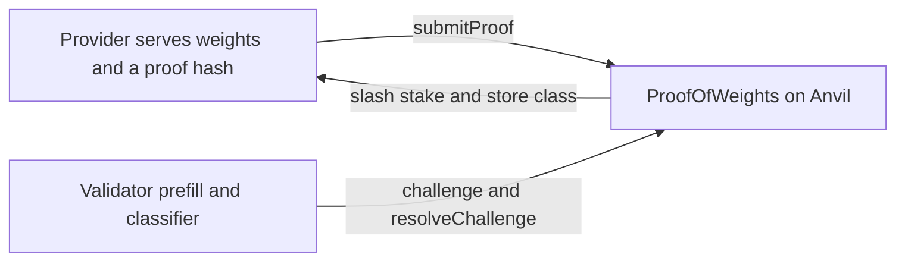

# Proof of Weights

Per-layer attribution and an optimistic slash on top of TOPLOC (Ong et al., ICML 2025, arXiv:2501.16007). The proof code is `toploc==0.1.6`. It is not reimplemented.

The live demo is a local page, not a public explorer. With the Anvil chain and `python dashboard/server.py` running, open http://127.0.0.1:8765. A backup recording of that page is `demo/slash-demo.webm`.

## What the demo shows

A provider staked 100 demo tokens and served a fine-tuned copy (`ft_drift`) instead of the committed bf16 weights. The check on prompt 3 measured an exponent mismatch of 57 against the calibrated limit 46.02. The classifier labeled the change `ft_drift` (class 4). The validator upheld the challenge. Stake on chain is 0.

| Field | Value |
|---|---|
| Chain | Anvil, chain id 31337, `http://127.0.0.1:8545` |
| Contract | `0xe7f1725E7734CE288F8367e1Bb143E90bb3F0512` |
| Stake token | `0x5FbDB2315678afecb367f032d93F642f64180aa3` (local mock) |
| Slash transaction | `0x6acf4f1e5fdcd88138307ed744a13a108108082a15d0f63b9b5dfb5a6cc6dd4d` |
| Class on chain | 4 (`ft_drift`) |

This is not Base Sepolia. Restarting Anvil from `contracts/anvil-state.json` restores the slash. The 100 tokens are not ETH.

## Problem

A GPU provider can answer a request with cheaper or altered weights. The caller sees fluent text and cannot tell. ZKML can prove execution, and it is far too expensive for a 1.5B model at serving time. TOPLOC can commit to activations with a small proof, and the published check is a boolean on the last hidden state. Ong et al. leave slight fine-tunes as open, and the proof itself does not take a stake.

## What was measured

Model: `Qwen/Qwen2.5-1.5B-Instruct`, revision `989aa7980e4cf806f80c7fef2b1adb7bc71aa306`, 28 layers, hidden size 1536. Generation length is 256 tokens, 8 checkpoints, EOS suppressed, natural EOS position stored. Train text is Alpaca. Eval text is UltraChat. Those sets are disjoint.

**Last-hidden proofs do not pass the reproduction gate.** On 200 prompts, calibrated thresholds catch 8-bit at 0%, 4-bit at 0%, merged LoRA at 59.5%, and full fine-tune drift at 54.5%. Held-out honest false-positive rate is 0.02. The paper's published thresholds `{38, 10, 8}` give held-out false-positive rate 0.23 on this setup, so the run uses the calibrated limits `{46.02, 25.80, 20.0}`. `results/phase_a_gate.json` records `passed: false`.

**Per-layer top-k profiles do separate the five classes.** Logistic regression, GroupKFold by prompt, matched prefill, all checkpoints: balanced accuracy 0.995 (std 0.0035, 95% interval 0.991–0.999). k-NN k=5 is 0.988. Fine-tune drift is not confused with clean (F1 1.0; 200/200). Shared text, same split: balanced accuracy 0.998, so the signal is not only a change of output text. Feature-path parity on 10 sequences is an exact match (max abs diff 0). Figures: `figures/layer_profiles.png`, `figures/confusion_matrix.png`.

**On this A10G, 8-bit and 4-bit are slower than bf16, not cheaper.** Three timed requests of 256 tokens: bf16 38.4 tokens/s and 3183 MiB, 8-bit 7.9 tokens/s and 1936 MiB, 4-bit 29.6 tokens/s and 1387 MiB. A validator prefill is 0.046 s, 0.69% of one bf16 generation. At the plan's on-demand rate of $1.006/hour, both quantized modes cost more time per request. At a 10% sampling rate the stake must exceed $0 for honesty to dominate on that time cost. The same floor is $0 at 1% and 5%. Quantization still uses less VRAM.

**An L4 does not look like tampering under the A10G classifier.** Fifty honest sequences, native bf16, compute capability 8.9. The L4 checking its own proofs flags 0/50 (largest exponent mismatch 9). Comparing L4 prefill top-k with the stored A10G baseline on the same tokens, the classifier calls all 50 clean.

No Day-2 cut. `shared` and `quant_8bit` were kept. The binary `TAMPERED = 255` fallback did not fire.

## Architecture



Verification stays off-chain. One validator address calls `resolveChallenge`. The chain stores the proof hash, the stake, and `getTamperHistory`. Anyone can post the challenge bond. Only the validator can decide it.

## Limitations

- One trusted validator. This is an optimistic record, not a trustless proof.
- Speculative decoding is undetectable by TOPLOC (Ong et al., §6.2). It is out of scope.
- Last-hidden proofs miss 8-bit and 4-bit on this model. The slash demo is one fine-tune that did exceed the threshold. It is not evidence that every cheat is caught.
- EOS is suppressed so every sequence has 8 checkpoints. Natural EOS is stored. Pre-EOS balanced accuracy on the matched split is 0.988.
- One model family, 1.5B. The L4 check is 50 sequences, and its proof false-positive rate is the L4 against itself.
- The contract is local Anvil. There is no public Base Sepolia transaction.

## Reproduce

GPU order matters. The account allows 8 GPU vCPUs. Run the A10G (`g5.xlarge`) first, stop it, then one L4 (`g6.xlarge`). Do not use a T4. Do not run both at once.

Locked choices are in `config.yaml`. The command log for each stage is the matching module under `inference/`. Thresholds, the gate, the classifier, cost, and the L4 check are in `results/`. Foundry tests live in `contracts/`. `forge test` passed 7 tests before the Anvil deploy.

Dashboard, after Anvil is listening on port 8545:

```text
python dashboard/server.py
```

Then open http://127.0.0.1:8765.
